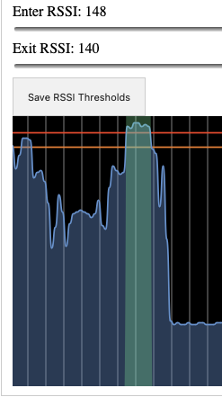

<p align="center"></p>

<p align="center"><b>Affordable single node FPV lap timer, driven from your Android phone over Bluetooth</b></p>

<p align="center"><a href="LICENSE"></a></p>

# About

GFPV Lapwing is a simple lap timing solution for 5.8GHz FPV pilots. It is designed for personal use and with small drones in mind (2 inch or less), but there is nothing against running it with bigger drones! The timer is a small, self powered ESP32 + RX5808 device that talks over Bluetooth Low Energy to the GFPV Lapwing Android app. The goal is a device that is easy to build and use anywhere, for a whoop race practice session in your living room or at a local training venue with friends, with no fuss.

It is based on [PhobosLT](https://github.com/phobos-/PhobosLT), the original idea and timing firmware, with WiFi and the web interface replaced by Bluetooth and a native Android app. See [Credits](#credits).

### Features

- Single node timing of 5.8GHz Analog, HDZero, Walksnail systems.
- Native Android app, connected over Bluetooth Low Energy.
- Voice callouts in French or English, optionally including the pilot name, that keep working with the screen off.
- Real time RSSI readout and calibration - allows for timing even in small spaces like a 16m^2 or 200 ft^2 room.
- 2 and 3 consecutive lap times, with optional callouts on the fly (handy for [RaceGOW](https://www.racegow.com/)).
- Race history saved on the phone, with best lap, average, best 3 consecutive laps and consistency.
- Minimum lap time to avoid false positives.
- Configurable low voltage alarm.
- Firmware updates over Bluetooth from the app.
- Open [BLE protocol](docs/BLE_PROTOCOL.md), so other clients can be written.
- Small size, easy to build, relatively cheap.

### How it works

The core of the project is an ESP32 board + an RX5808 module. The ESP32 is a Bluetooth Low Energy (BLE) peripheral, and the GFPV Lapwing Android app connects to it to configure the timer and measure lap times.

The lap timing happens by measuring the RSSI over time, filtering it and checking for peaks in the RSSI as the closer the drone is to the timer the higher the RSSI. Based on that we set up an `Enter RSSI` and `Exit RSSI` thresholds, that tell us when to cut a peak. The time between the enter and exit RSSI is then used to measure the time between the last peak and the current peak which is a lap.

The timer exposes a single BLE service: the configuration is read and written as JSON, the race is started and stopped with control commands, and laps, battery status and (on the calibration screen only) live RSSI are sent as notifications. Firmware updates use the same connection. The full protocol is described in [docs/BLE_PROTOCOL.md](docs/BLE_PROTOCOL.md). Dropping WiFi keeps the 2.4GHz radio quiet while timing and leaves more memory free.

The phone emits the start tone and calls out lap times with Android's text-to-speech. An optional (but recommended) beeper can be installed on the timer to also emit a sound every time a peak is detected or to alert e.g. when the timer battery voltage is low.

# How to build one

### Hardware

To build a timer you will need:
- An ESP32 breakout board, preferably with USB. The codebase is plug and play with `LilyGo T-ENERGY` which has a built in 1s 18650 Li-Ion cell slot and voltage sensing circuit out of the box. Supported boards:
    - LilyGo T-ENERGY - recommended.
    - LilyGo T-CELL - more expensive than the one above but has a charging circuit.
    - ESP32-DevKit - bare bones but cheap.
- An RX5808 VRx module with [SPI mod](https://sheaivey.github.io/rx5808-pro-diversity/docs/rx5808-spi-mod.html).
- A voltage supply of any sort - a battery, a powerbank, etc. It will depend on the ESP32 module used.
- (Optional) An LED of any color (+ a matching resistor to manage current).
- (Optional) A 3v3 to 5v buzzer WITH a generator (so active and not passive).

To connect the RX5808 to the ESP32 use below pinout table. Please note that +5v pin on the RX5808 should be connected to a 3v3 source to undervolt the RX5808 to get a better RSSI resolution and to help with cooling:
| ESP32 PIN | RX5880 |
| :------------- |:-------------|
| 33 | RSSI |
| GND | GND |
| 19 | CH1 |
| 22 | CH2 |
| 23 | CH3 |
| 3V3 | +5V |

Optional but recommended LED, Buzzer and Battery voltage input pinout:
| ESP32 PIN | Peripheral |
| :------------- |:-------------|
| 21 | LED anode (+) |
| 27 | Buzzer positive (+) |
| 35 | VBAT input MAX 3.3v (the code assumes a 1/2 voltage divider with a 1s Li-Ion  cell) |

You can find a connection diagram of the peripherals below. **For T-Energy and T-Cell you just need to connect the RX5808 and a buzzer.**


#### 3D printed cases
[ESP-WROOM-32 case by porlock](https://makerworld.com/en/models/400720)

### Firmware

Currently building the firmware happens via Visual Studio Code. The toolchain setup is exactly the same as for ExpressLRS, so if you already have an ExpressLRS toolchain set up and running, you should be good. The requirements to build the firmware are as follows:
- Visual Studio Code.
- PlatformIO.
- Git.

#### Toolchain setup

Perform these steps to set the toolchain up on your computer:
1. Download and install [vscode](https://code.visualstudio.com/).
2. Open vscode, and click on the `Extensions` icon in the toolbar on the right (see [Managing Extensions](https://code.visualstudio.com/docs/editor/extension-marketplace)).
3. In the search box, enter platformio, and install the extension (see the `pio install` [documentation](https://platformio.org/install/ide?install=vscode)).
4. Install [git](https://github.com/git-guides/install-git).

The last step before you can build the firmware is to clone this repository to your computer:
- In VSCode open the command palette (using `Cmd+Shift+P` on MacOS or `Ctrl+Shift+P` on Windows)
- Enter `Git: Clone`.
- Click it.
- Then, enter this repository URL: `https://github.com/arnaudmorin/fpv-android-ble-timer.git`.
- Choose a folder where you want your copy of the repository to be located.

#### Building

To build the firmware, click the `PlatformIO` icon in the toolbar on the left, which will show the list of tasks. Now, select `Project Tasks`, expand your target (`ESP32`, `ESP32C3` or `ESP32S3`) -> `General` and select `Build`. You should see the result in the terminal after a few seconds (`Success`).

#### Flashing

Before attempting to flash ensure there is a connection between the ESP32 and the computer via USB. Click the `PlatformIO` icon in the toolbar on the left, which will show the list of tasks. Now, select `Project Tasks`, expand your target (`ESP32`, `ESP32C3` or `ESP32S3`) -> `General` and select `Upload`. You should see the result in the terminal (`Success`). That's it! Your timer is ready to use.

From the command line, the same is `pio run -e ESP32 -t upload` (or `-e ESP32C3` / `-e ESP32S3`).

If something went wrong - please check the Terminal, too. It will contain at least a hint of what the issue is.

**Upgrading a timer running the original WiFi PhobosLT firmware:** the first Bluetooth firmware has to be flashed over USB. The stored settings are reset once to defaults, because the WiFi fields were removed from them. There is no file system image to upload anymore.

#### Updating over Bluetooth

Once a Bluetooth firmware is installed, later updates can be done from the app without a cable. The release APK includes the firmware built with it: when the app connects to a timer running an older version, it proposes the update right away (`Later` hides the proposal for that version, the update stays available in `Settings` › `Firmware update`). Timers running a local build (`dev`) are not prompted, but can install the included firmware from `Settings`.

To install another firmware: open `Settings`, scroll to `Firmware update`, choose the new firmware file (a `GFPV-Lapwing-firmware-<chip>-v1.0.<n>.bin` from the [Releases](https://github.com/arnaudmorin/fpv-android-ble-timer/releases) page, or `.pio/build/<target>/firmware.bin` after a local build) and tap `Update timer`. The app refuses images built for another chip, and the timer checks the image's MD5 and validity before switching to it, so an interrupted or corrupt transfer leaves the current firmware running. The timer reboots when done and the app reconnects by itself. Use these application images, not a merged/factory image.

### Android app

The app lives in the `android/` folder. It needs Android 8.0 or newer with Bluetooth LE.

To build it you need a JDK 17 or 21 (a full JDK, not just a runtime) and the Android SDK (installed with [Android Studio](https://developer.android.com/studio), or the command line tools). Either open the `android/` folder in Android Studio and press Run, or build from the command line:

```
cd android
./gradlew assembleDebug
adb install app/build/outputs/apk/debug/app-debug.apk
```

`./gradlew testDebugUnitTest` runs the unit tests. `./gradlew assembleRelease` builds the signed release APK (`app/build/outputs/apk/release/app-release.apk`).

### Downloads, CI and releases

You don't have to build anything yourself: every push to `main` publishes a GitHub release `v1.0.<run number>` on the [Releases](https://github.com/arnaudmorin/fpv-android-ble-timer/releases) page with:
- `GFPV-Lapwing-v1.0.<n>.apk` - the signed Android app, with the firmware of the same release inside. Each release installs as an update of the previous one.
- `GFPV-Lapwing-firmware-ESP32-v1.0.<n>.bin`, `...-ESP32C3-...` and `...-ESP32S3-...` - the firmware for each chip, to [install from the app](#updating-over-bluetooth). The app shows the timer's firmware version as `1.0.<n>`.

This is done by `.github/workflows/build.yml`, which also runs the unit tests and lint. Pull requests are built and tested without a release. Local firmware builds report their version as `dev`.

### Signing

The release key (`android/signing/release.jks`) and its passwords (`android/signing/keystore.properties`) are committed on purpose so CI needs no secrets and every build has the same signature. The trade-off: anyone who can read this repository can sign an APK that installs as an update of the app. Since this repository is public, consider moving the key to GitHub secrets and rotating it if that matters to you.

# Usage

This section describes the usage and configuration of the timer with the Android app. The app has 4 tabs: `Race`, `Calibrate`, `Settings` and `Stats`.

### First connect

1. Turn on the timer, you should hear a short and a long beep.
2. Open the GFPV Lapwing app and grant Bluetooth access when asked (on Android 11 and older Android calls it location access, and location services must be on to scan). Allow notifications too: they show the connection status while racing.
3. The app scans for timers. Tap the one named `Lapwing_xxxx`. The timer beeps when a phone connects.
4. Voila! Next time, `Reconnect to Lapwing_xxxx` connects in one tap.

If the timer goes out of range or reboots, the app reconnects on its own as soon as it is back. Up to 3 phones can be connected at the same time, e.g. a spotter can follow the laps too.

### Configuration

To configure the timer open the `Settings` tab. Below you can find all the config parameters and their description:

**Pilot name** - when filled it will include pilot name when reading the times, e.g. `Pilot1 Tour 3, 23,45` (in English `Pilot1 Lap 3, 23.45`). It is useful when there is more than just one timer running at the same time. When practicing alone leave it empty.
**Band and Channel** - set to the same Band and Channel as your drone. Supported Bands - A, B, E, Fatshark, RaceBand and LowBand, 8 channel each. The frequency is displayed below. Until a channel is chosen the RX5808 stays powered down (`RX off`).
**Minimum lap time** - you can set a minimum lap time that can be timed. This avoids false positives when you crash in the start gate, or when your track is very tight and you fly in close proximity to the timer multiple times during one lap.
**Low battery alarm** - turn it on to beep when the timer battery drops to the chosen voltage, between 3.0 and 4.0 V (3.6 V by default). The current voltage is shown at the top of the app.
**Announcer** - you have a few options on how you want the app to report lap times:
- `None` is no sound at all.
- `Beep` will just emit a short beep on crossing to let you know it registered a lap.
- `Lap time` will announce the lap time (including your pilot name if the **Pilot name** field is filled).
- `2 consecutive laps` will announce the two consecutive lap time.
- `3 consecutive laps` will announce the three consecutive lap time.

**Voice language** - callouts are in French by default, English can be chosen instead. This is stored on the phone and applies immediately. If the phone has no voice for the chosen language, the app tells you to install it in Android settings › Text-to-speech output.
**Voice speed** - controls the speed of the announcer reading the lap time. `Test voice` lets you try it.

Callouts use the phone's media volume, and keep working with the screen off or another app in front.

Changes are sent to the timer automatically, there is nothing to save. The `Timer` section at the bottom shows the timer's chip and firmware version and hosts the [firmware update](#updating-over-bluetooth).

### Calibration

Calibartion is a very important step and it needs to be done properly to ensure the timing happens correctly and every lap is counted by the timer.

To perform the calibration open the `Calibrate` tab. You should be presented with a graph representing the RSSI over time, updated 10 times per second. You can think of RSSI as an inverse of the distance between the drone and the timer. The higher the RSSI the shorter the distance.

A node can be either `Crossing` or `Clear`. If a node is `Clear`, the timer believes a drone is not near the timer because the RSSI is low. If it is `Crossing`, the timer believes a drone is passing by the timer because the RSSI is high. A lap pass will be recorded once the `Crossing` is finished and the RSSI returns to `Clear` zone. We calibrate that by setting `Enter` and `Exit` RSSI thresholds.

A well calibrated timer will show the lap time when we have only one crossing when drone is the closest to the timer, e.g. (screenshot from the original PhobosLT web interface, the app graph uses the same colors):



`Crossing` will always be marked in green, the RSSI is drawn in blue, and the `Enter` and `Exit` thresholds are the red and orange lines. Set the thresholds by dragging the red and orange lines with a finger, or with the two sliders below the graph. Changes are saved to the timer automatically.


To come up with good initial values for `Enter` and `Exit` RSSI perform these steps:
1. Turn on the timer and your drone, set it to the desired VTx power, wait 30 seconds for the VTx to reach its running temperature.
2. Place the drone at a distance of slightly more than one gate above the timer. 
3. Note the RSSI, deduct 2-5 points to be safe - that should be your `Enter RSSI`. 
4. Deduct another 8-10 points and set it as your `Exit RSSI`. 

When flying with other pilots the RSSI readings might be lower due to all the noise generated by other VTxs on adjecent channels. A good practice is to lower both thresholds by a few points when flying with other pilots in the air.

### Race and lap management

The `Race` tab lets you start or stop a race and view and clear your lap times. The screen stays on while it is open.

Functions of the buttons:
- `Start` - starts the countdown: the app says "Armez votre drone", then "Départ au bip dans moins de cinq secondes" (in English: "Arm your quad", "Starting on the tone in less than five"), waits a random 1 to 5 seconds and plays the start tone, at which point the timer starts counting laps.
- `Stop` - press it when you want to stop counting new laps. It does not clear the laps collected so far.
- `Clear` - clears the laps on the screen, can be done when the race is running as well.

The first lap reported is the hole shot (`HS`), the time from the start tone to the first gate crossing. Each following row shows the lap time and the 2 and 3 consecutive lap times, with the best lap highlighted, and the number of laps, best lap, average and best 3 consecutive laps are shown above the table.

### Stats

Every race with at least one lap is saved on the phone. The `Stats` tab lists them with their date, pilot, number of laps and best lap. At the top, two tiles show your all-time best lap and best 3 consecutive laps (with the three lap times), and once two races are saved a `Progression` card charts the best lap and the best 3 consecutive laps of each race over time, oldest on the left: lower is faster. Tap a race to see all its laps, the hole shot, and its consistency (standard deviation of the lap times: lower is more consistent). Races can be shared as text or deleted.

# Credits

- [PhobosLT](https://github.com/phobos-/PhobosLT) by Paweł Stefański - the original idea, hardware design and lap timing firmware this project is built on.
- Parts of the timing code are based on [RotorHazard](https://github.com/RotorHazard/RotorHazard) and [ExpressLRS](https://github.com/ExpressLRS/ExpressLRS). Big kudos to the people behind these projects, they are doing A LOT for the FPV community.

# License

MIT, see [LICENSE](LICENSE). The original PhobosLT copyright notice is kept as required by the license.
